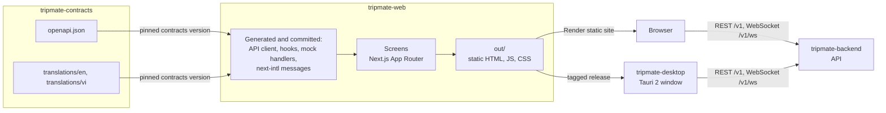
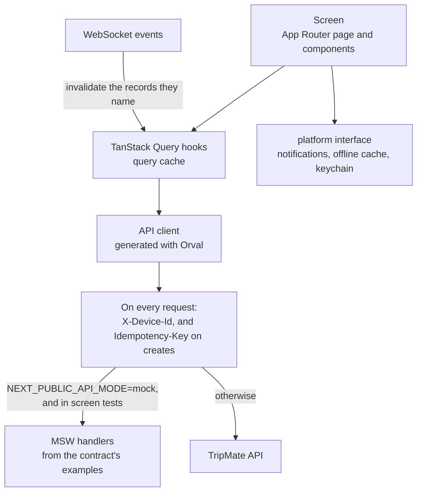
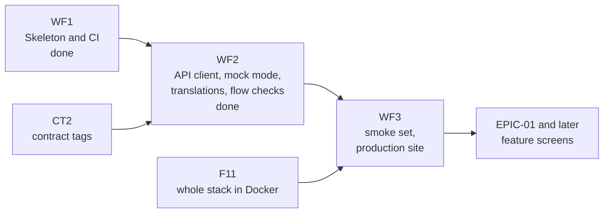

# tripmate-web

The TripMate Web client. It holds every screen of TripMate for
browsers, and the Desktop client (`tripmate-desktop`) runs the same
build inside a native window.

It is a Next.js App Router project in TypeScript strict mode, built as
a static export: plain HTML, JavaScript and CSS, with no server of its
own. Every screen gets its data from the TripMate API in the browser
([ADR-0007](https://github.com/huynguyennang-agilityio/tripmate-docs/blob/main/docs/adr/0007-web-client-is-a-static-build.md)).

| | |
|---|---|
| Status | Skeleton, CI, generated API client, mock mode, and messages in place (EPIC-11, cards WF1 and WF2). One test screen, `/health`; no feature screens yet. |
| Product documents | [tripmate-docs](https://github.com/huynguyennang-agilityio/tripmate-docs) |
| Rules for contributors and AI agents | [CLAUDE.md](CLAUDE.md) |
| Tasks of this repository | [tasks/EPIC-11.md](tasks/EPIC-11.md) |

## Contents

- [Architecture](#architecture)
- [Tech stack](#tech-stack)
- [Code structure](#code-structure)
- [Getting started](#getting-started)
- [Checks and CI](#checks-and-ci)
- [Environments](#environments)
- [Roadmap of this repository](#roadmap-of-this-repository)
- [Further reading](#further-reading)

## Architecture

### Where the Web client sits



- **One build, two hosts.** `npm run build` writes the site to `out/`.
  Render serves it to browsers, and `tripmate-desktop` bundles a
  tagged release of it.
- **No server code.** No server rendering, no API routes, no server
  actions, no middleware. Nothing in TripMate is public, so server
  rendering would add nothing, and Desktop needs files it can bundle.
- **No domain rules in the client.** Money, voting and Gap logic live
  in the backend. The client shows data and sends commands.
- **No secrets in the client.** The repository and the build are
  public.
- **Paths with a variable part are read in the browser.** For example,
  the host serves the join page for every `/join/*` path, and the page
  reads the code from the URL.

### Inside the client

This is the shape the foundation cards build. WF1 built the App Router
skeleton and WF2 the client, mock mode, and messages.



| Part | What it does | Card |
|------|--------------|------|
| Screens | App Router pages and components, all rendered in the browser | WF1 (skeleton), EPIC-01 and later (features) |
| API client and hooks | A typed client and TanStack Query hooks, generated with Orval from the pinned contracts version. The query cache holds server data, and WebSocket events invalidate the records they name. | WF2 |
| Request headers | `X-Device-Id` on every request, kept across reloads. `Idempotency-Key` on creates: the same key for retries of one action, a new key for a new action. | WF2 |
| Mock mode | MSW handlers generated with the client answer from the contract's examples. It is on when `NEXT_PUBLIC_API_MODE=mock` and in screen tests, and never in a production build. | WF2 |
| Translations | `next-intl` messages in Vietnamese and English, generated from the pinned contracts version. A key that version does not have is a type error and throws at render. | WF2 |
| `platform` interface | Hides what differs inside Desktop (notifications, offline cache, keychain). On the plain Web it does nothing or uses browser features. | Not in a card yet |

The full picture is in
[architecture.md](https://github.com/huynguyennang-agilityio/tripmate-docs/blob/main/docs/architecture.md),
sections 3 and 8.1, and the
[EPIC-11 spec](https://github.com/huynguyennang-agilityio/tripmate-docs/blob/main/docs/specs/epic-11/spec.md),
section 2.11.

## Tech stack

Versions are exact in `package.json` and locked in
`package-lock.json`, so every machine and CI install the same thing.

### In use now

| Area | Tool | Version | Notes |
|------|------|---------|-------|
| Runtime | Node.js | 24 LTS | `.nvmrc` is `24`; `engines` is `>=24 <25`, enforced by `engine-strict` in `.npmrc` |
| Package manager | npm | 11, the one bundled with Node 24 | Install with `npm ci` |
| Framework | Next.js | 16.4.6 | App Router, `output: "export"` |
| API client and hooks | Orval 8.49.0, `@tanstack/react-query` 5.108.4 | | Generated into `src/api/generated/` from the pinned contracts version |
| Mock mode | MSW | 2.15.0 | Handlers generated from the contract's examples. Not 3.x: its package has no `require` entry for `msw/browser`, which the WF2-7 test resolves. |
| Translations | `next-intl` | 4.16.2 | Messages generated into `src/messages/` |
| Contracts | `tripmate-contracts` | `contracts-v0.2.0` | npm git dependency on a tag; the lock file records the commit |
| UI | React, React DOM | 19.3.1 | |
| Language | TypeScript | 6.0.3 | `strict: true`. Not 7.x: `typescript-eslint` supports `<6.1.0`. |
| Lint | ESLint | 9.39.5 | Flat config with `eslint-config-next` 16.4.6, `--max-warnings=0`. Not 10.x until `eslint-config-next` supports it. |
| Unit and screen tests | Vitest | 5.1.1 | With `@vitejs/plugin-react` 6.3.0 |
| | Testing Library | `@testing-library/react` 16.3.3, `@testing-library/dom` 10.4.2 | |
| | jsdom | 31.0.1 | The test DOM |
| Types | `@types/node`, `@types/react`, `@types/react-dom` | 24.19.2, 19.3.1, 19.3.0 | |
| CI | GitHub Actions | `actions/checkout` v7.0.1, `actions/setup-node` v7.1.0 | Pinned to commit SHAs in `.github/workflows/ci.yml` |

### Added by later cards

The spec chooses these tools. Their versions are pinned by the card
that adds them.

| Area | Tool | Card |
|------|------|------|
| End-to-end smoke set | Playwright | WF3 |

## Code structure

```text
tripmate-web/
├── .claude/agents/          The four agent roles: test, code, test-check, diff review
├── .github/
│   ├── workflows/           ci.yml, flow.yml (flow checks), risk-gate.yml
│   └── risk-paths.toml      Path list of the risk gate
├── scripts/
│   ├── check-line-endings.mjs   Fails on any CRLF or changed file (Node only)
│   ├── check-contracts.mjs      Fails when the generated files differ from the pinned contracts
│   ├── generate-contracts.mjs   Writes src/api/generated and src/messages
│   └── lib/contracts.mjs
├── src/
│   ├── app/                 Next.js App Router: layout, providers, home, /health test screen
│   ├── api/                 client.ts (apiFetch, headers), mode.ts, generated/ (Orval, committed)
│   ├── mocks/               MSW handlers, browser worker, Vitest setup file
│   ├── messages/            en.json, vi.json (generated for next-intl)
│   └── i18n/                Typed messages
├── tests/                   Vitest tests, mirroring src/
│   └── app/
│       └── page.test.tsx
├── tasks/
│   ├── EPIC-11.md           Task file: scope, risk, test cases of each card
│   └── EPIC-11-notes/       Review notes, one file per card
├── .gitattributes           LF on every OS; images and fonts are binary
├── .nvmrc, .npmrc           Node 24, engine-strict
├── next.config.ts           Static export; refuses a production build with mock mode
├── orval.config.mjs         Orval generation from the pinned contract
├── tsconfig.json            TypeScript strict
├── eslint.config.mjs        ESLint flat config
├── vitest.config.mts        Vitest with jsdom
├── CLAUDE.md                Rules for contributors and AI agents
└── package.json, package-lock.json
```

| Rule | Why |
|------|-----|
| Application code lives in `src/`, tests in `tests/` with the same paths | A test file is never mixed with app files, so the flow checks can tell a test commit from a code commit |
| Shared scripts are Node (`.mjs`), never PowerShell or bash | They run the same on Windows and macOS |
| Every text file is LF (`.gitattributes`) | The work runs on Windows and macOS; a fresh checkout shows no changed file on either |
| Nothing server-only: no `route.ts`, server actions, middleware, `headers()` or `cookies()` | The static export cannot run them |

New folders come with the card that needs them, and this section is
updated in that card. `src/api/generated/` and `src/messages/` are
generated: change the pin and run `npm run generate:contracts`, never
edit them by hand.

## Getting started

You need Node.js 24 (see `.nvmrc`) and Git. No global tools are
needed.

```sh
git clone https://github.com/huynguyennang-agilityio/tripmate-web.git
cd tripmate-web
npm ci
npm run dev        # http://localhost:3000, API at NEXT_PUBLIC_API_URL (default http://localhost:8000)
```

Mock mode answers from the contract's examples, with no backend:

```sh
NEXT_PUBLIC_API_MODE=mock npm run dev    # then open /health
```

On PowerShell: `$env:NEXT_PUBLIC_API_MODE="mock"; npm run dev`. A production
build with that setting fails on purpose. `NEXT_PUBLIC_*` values are public;
never commit a `.env` file.

On Windows, no Git setting is needed: `.gitattributes` keeps every
file LF whatever `core.autocrlf` is.

## Checks and CI

Run the same checks as CI before opening a pull request:

| Command | What it does | CI check (required on `main`) |
|---------|--------------|-------------------------------|
| `npm run lint` | ESLint; fails on any warning | `lint` |
| `npm run typecheck` | `next typegen`, then `tsc --noEmit` | `typecheck` |
| `npm test` | Vitest once, in jsdom | `test` |
| `npm run build` | Static export to `out/`; CI also checks that `out/index.html` exists | `build` |
| `npm run check:contracts` | Regenerates the client and messages from the pinned contracts version and fails when they differ from the committed files | `check-contracts` |
| `npm run check:eol` | Fails when the tree has any changed file, or any text file has a CRLF or mixed ending | `line-endings (windows-latest)`, `line-endings (macos-latest)` |

- Each check owns one kind of problem. `next build` skips type checking
  and does not lint, so a type error fails only `typecheck`, and a lint
  error fails only `lint`.
- CI runs on every pull request and on every push to `main`.
- `main` is protected: every change goes through a pull request, and
  all seven checks above, and the flow checks, must pass.
- The flow checks are `flow / failing-first`, `flow / test-lock` and
  `gate / risk-gate` (the risk gate needs the `human-approved` label for
  a High change). A later card adds the end-to-end smoke set.

## Environments

| Environment | Where | API |
|-------------|-------|-----|
| Local | `npm run dev` on `localhost:3000` | The local stack in Docker (`docker compose up` in `tripmate-backend`), or mock mode with `NEXT_PUBLIC_API_MODE=mock` |
| CI | GitHub Actions | Mock mode for screen tests (MSW server in `src/mocks/vitest.setup.ts`); the local stack in Docker for the smoke set (from WF3) |
| Production | A Render static site that serves the join page for every `/join/*` path (from WF3) | The production API |

A staging environment is added before the beta. Environment settings
are public `NEXT_PUBLIC_*` values only. Never commit a `.env` file.

## Roadmap of this repository



What each card does, and the test cases that close it, are in
[tasks/EPIC-11.md](tasks/EPIC-11.md).

## Further reading

| Question | Document |
|----------|----------|
| How to work in this repository | [CLAUDE.md](CLAUDE.md) |
| What TripMate must do | [prd.md](https://github.com/huynguyennang-agilityio/tripmate-docs/blob/main/prd.md) |
| How the system fits together | [architecture.md](https://github.com/huynguyennang-agilityio/tripmate-docs/blob/main/docs/architecture.md) |
| How clients talk to the backend | [api-design.md](https://github.com/huynguyennang-agilityio/tripmate-docs/blob/main/docs/api-design.md) |
| Security rules for clients | [security.md](https://github.com/huynguyennang-agilityio/tripmate-docs/blob/main/docs/security.md) |
| How it is tested | [test-strategy.md](https://github.com/huynguyennang-agilityio/tripmate-docs/blob/main/docs/test-strategy.md) |
| How a card goes from task to merge | [development-flow.md](https://github.com/huynguyennang-agilityio/tripmate-docs/blob/main/docs/development-flow.md) |
| Domain terms | [GLOSSARY.md](https://github.com/huynguyennang-agilityio/tripmate-docs/blob/main/GLOSSARY.md) |
